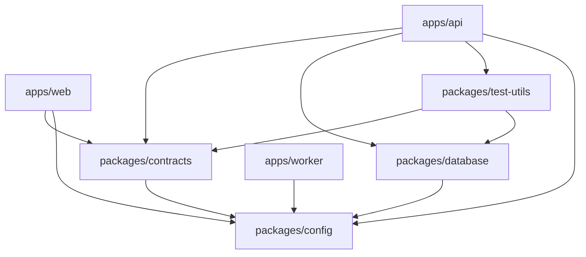

# WorkSpace Architecture Documentation

## 1. System Overview

**WorkSpace** is a production-oriented, multi-tenant Software-as-a-Service (SaaS) application designed for project management, collaborative task coordination, and organizational team isolation.

This document describes the foundational architecture established in Phase 1 and outlines boundaries for future milestones across the 12-week roadmap.

---

## 2. Monorepo Topology & Boundaries

The codebase is organized as a Turborepo-managed monorepo using pnpm workspaces:

```
workspace-saas/
├── apps/
│   ├── web/               # Next.js App Router frontend (Port 3000)
│   ├── api/               # Express + TypeScript REST API (Port 4000)
│   └── worker/            # Background queue & asynchronous jobs runtime
├── packages/
│   ├── contracts/         # Unified API contracts, response envelopes, & Zod schemas
│   ├── database/          # Prisma schema, client singleton, & connection telemetry
│   ├── config/            # Base TypeScript compiler and linting configurations
│   └── test-utils/        # Shared mock factories and assertion test helpers
├── infra/
│   └── docker/            # Container definitions & local infrastructure scripts
├── docs/                  # Architectural guidelines & engineering standards
└── .github/workflows/     # Automated Continuous Integration pipelines
```

### Application Boundaries

1. **`apps/web` (Frontend Client)**:
   - Built on Next.js App Router (React, TypeScript, Tailwind CSS).
   - Responsible strictly for presentation, client-side routing, and rendering UI.
   - Communicates with the backend exclusively via the typed `ApiClient` configured from `NEXT_PUBLIC_API_URL`.
   - Never communicates directly with the database or backend secrets.

2. **`apps/api` (Backend Service)**:
   - Built on Express with TypeScript.
   - Encapsulates HTTP lifecycle, request correlation (`x-request-id`), input validation, and business logic.
   - Implements two distinct health checks:
     - **Liveness probe (`GET /api/v1/health`)**: Verifies the process is responsive.
     - **Readiness probe (`GET /api/v1/ready`)**: Verifies critical downstream dependencies (PostgreSQL database ping).
   - Centralized error handling guarantees that production responses never expose internal stack traces, database credentials, or system errors.

3. **`apps/worker` (Job Execution Runtime)**:
   - Dedicated Node.js process decoupled from HTTP traffic.
   - Reserved for deferred compute: transactional emails, notifications, data export/import, and billing webhooks in future phases.
   - Includes graceful signal trapping (`SIGTERM`, `SIGINT`) to finish running tasks cleanly before termination.

---

## 3. Shared Packages & Dependency Graph



- **`@workspace/contracts`**: Single source of truth for API response envelopes (`ApiResponse<T>`, `ApiErrorResponse`), error codes (`ErrorCode`), and validation schemas.
- **`@workspace/database`**: Encapsulates Prisma Client, migration schemas, and the database connectivity verification function (`checkDatabaseConnection()`).
- **`@workspace/config`**: Houses strict `tsconfig.base.json`, `tsconfig.node.json`, and `tsconfig.react.json`.
- **`@workspace/test-utils`**: Provides shared mock generators for tests without polluting production code.

---

## 4. Multi-Tenancy Strategy (Planned Architecture)

In upcoming milestones, WorkSpace will enforce strict organizational multi-tenancy:

- **Tenant Context Propagation**: Tenant identifier (`tenantId`) parsed and cryptographically validated from authentication tokens or subdomains.
- **Data Isolation**: Multi-tenant Prisma client extension injecting row-level filtering (`tenantId = currentTenant`) across all read and write queries.
- **Cross-Tenant Guardrails**: Direct database queries without explicit tenant filters are forbidden outside administrative maintenance scripts.

---

## 5. Reliability & Observability Standards

- **Request ID Tracking**: Every inbound request receives or preserves an `x-request-id` header passed throughout logger and error boundaries.
- **Fail-Fast Configuration**: All environment variables are validated at boot time via Zod schemas (`env.ts`). If required variables are absent or invalid, the process halts immediately with descriptive diagnostic logs.
- **Graceful Termination**: HTTP servers stop accepting new connections and drain existing transactions before terminating Prisma connections.

---

## 6. Migration and Database Lifecycle

- **Development**:
  ```bash
  pnpm --filter @workspace/database db:migrate:dev
  ```
  Applies schema diffs interactively and regenerates the Prisma client.
- **Continuous Integration & Production**:
  ```bash
  pnpm --filter @workspace/database db:migrate:deploy
  ```
  Applies pre-calculated migrations non-interactively without prompting.
